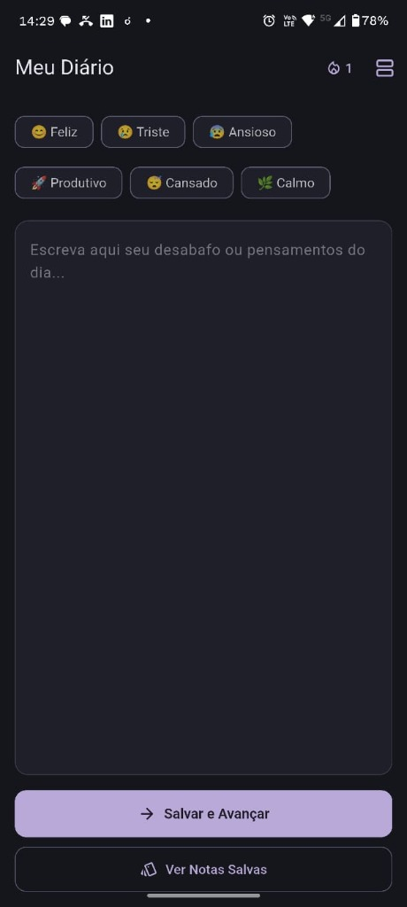
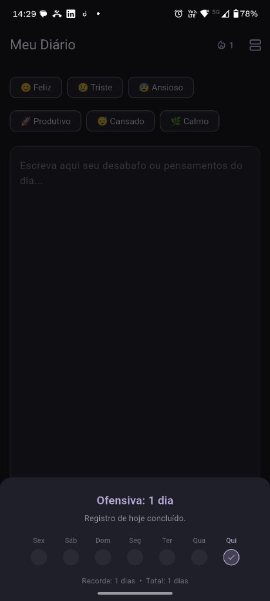
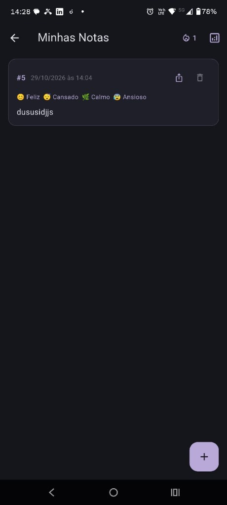

# 📓 Meu Diário — Diário Emocional Minimalista (Offline-First)

O **Meu Diário** é um aplicativo mobile desenvolvido em **Flutter** com persistência local em **SQLite (`sqflite`)**, projetado para registrar pensamentos diários, acompanhar o estado emocional, manter o hábito de escrita por meio de **Ofensivas (Streaks)** e exportar registros em **Markdown (`.md`)** organizados por pastas.

O design adota uma estética **Dark Minimalista com paleta Lavanda Calma (`#B8A9D9`)**, pensada para proporcionar conforto visual (especialmente à noite) e foco total na escrita, sem poluição na tela principal.

---

## 📱 Telas do Aplicativo e Como Funcionam

<p align="center">
  
  &nbsp;&nbsp;&nbsp;
  
  &nbsp;&nbsp;&nbsp;
  
</p>

### 1. Tela Principal (`Meu Diário`)
A primeira tela foi desenhada para ser **100% limpa e direta ao ponto**:
- **Seletor de Emoções (`FilterChip`):** No topo, o usuário pode selecionar uma ou mais emoções que representam seu dia (`😊 Feliz`, `😢 Triste`, `😰 Ansioso`, `🚀 Produtivo`, `😴 Cansado`, `🌿 Calmo`).
- **Área de Escrita Livre:** Um campo de texto amplo em tom grafite escuro (`#1F1F29`) onde o usuário escreve seu desabafo ou anotações do dia.
- **Botão `Salvar e Avançar`:** Salva o registro de forma transacional no banco SQLite local e avança automaticamente para a visualização em Cards.
- **Botão `Ver Notas Salvas`:** Permite ir diretamente para a galeria de cards sem precisar criar uma nota antes.
- **Indicador de Ofensiva (`🔥 1`) e Acesso Rápido na AppBar:** No canto superior direito, exibe de forma discreta a sequência atual de dias seguidos escrevendo e o atalho para a lista de notas.

---

### 2. Painel Minimalista de Ofensiva (`Ofensiva / Streak`)
Ao tocar no ícone `🔥` na barra superior, abre-se um *Bottom Sheet* minimalista:
- **Contador de Sequência Atual:** Mostra quantos dias consecutivos o usuário registrou ao menos uma nota no diário e informa se o registro do dia atual já foi concluído.
- **Linha do Tempo dos Últimos 7 Dias (`Sex` a `Qui`):** Exibe círculos representando a última semana, marcando com `✓` em lavanda os dias em que houve registro e destacando o dia atual.
- **Histórico de Consistência:** Mostra no rodapé o **Recorde** (maior sequência histórica atingida) e o **Total de dias** registrados no aplicativo.

---

### 3. Tela `Minhas Notas` (Visualização em Cards)
Ao salvar uma nota ou tocar em *Ver Notas Salvas*, o usuário avança para a tela de **Cards**:
- **Cards de Registro:** Cada nota é exibida em um card individual contendo:
  - **ID Inteligente (`#1`, `#2`, ...):** Quando uma nota é excluída, seu ID é **liberado e reutilizado automaticamente** pela próxima nota criada, mantendo a numeração limpa e sem buracos eternos.
  - **Data e Hora Formatadas:** Exemplo: `29/10/2026 às 14:04`.
  - **Tags Emocionais:** Lista as emoções associadas àquela nota com seus respectivos emojis.
  - **Texto do Registro:** O conteúdo completo escrito pelo usuário (tocar no card carrega a nota de volta na tela principal caso queira editá-la).
- **Exportação sob demanda para Markdown (`.md`) por Pasta (Ícone de Compartilhar/Exportar):**
  - Ao tocar no ícone de exportação dentro do card, abre-se uma janela onde o usuário escolhe (ou cria) a **pasta** desejada (`Geral`, `Desabafos`, `Ideias`, `Metas`, ou qualquer nova pasta) e pode **Salvar o arquivo `.md`** separado naquela pasta ou **Copiar o código Markdown** formatado.
- **Resumo Emocional Semanal (Ícone de Gráfico na AppBar):** Executa uma consulta agregada (`INNER JOIN` + `GROUP BY`) dos últimos 7 dias e mostra a frequência de cada emoção (`Feliz: 3x`, `Calmo: 2x`, etc.).
- **Botão Flutuante (`+`):** Retorna rapidamente para a tela de criação de uma nova nota.

---

## 🛠️ Especificações Técnicas (Tech Specs)

| Camada / Recurso | Especificação |
| :--- | :--- |
| **Framework & Linguagem** | Flutter `>=3.0.0 <4.0.0` • Dart 3 (Null Safety) |
| **Design System** | Material 3 (`useMaterial3: true`) • Tema Escuro Nativo (`#15151C` / `#1F1F29`) com acento Lavanda (`#B8A9D9`) |
| **Banco de Dados Local** | SQLite via `sqflite: ^2.3.0` e `path: ^1.9.0` (100% Offline, sem dependência de nuvem) |
| **Modelagem Relacional** | Tabelas `notas`, `nota_emocoes` (relação N:N com `FOREIGN KEY ... ON DELETE CASCADE`) e `pastas` |
| **Gerenciamento de IDs** | Algoritmo `_obterMenorIdLivre` em transação SQLite para reciclar IDs de notas excluídas |
| **Exportação de Arquivos** | Geração de arquivos `.md` estruturados em diretórios por categoria (`markdown_notas/<Pasta>/nota_<id>.md`) |

### 📂 Arquitetura de Pastas (`lib/`)
```text
lib/
├── main.dart                          # Configuração do MaterialApp, Tema Escuro/Lavanda e rota inicial
├── core/
│   └── database/
│       └── app_database.dart          # Singleton do SQLite, criação de tabelas (v2), PRAGMA foreign_keys e migrações
├── models/
│   ├── emocao.dart                    # Enum Emocao com rótulo e emoji
│   └── nota.dart                      # Modelo de domínio Nota, validação e conversor toMarkdown()
├── repositories/
│   └── nota_repository.dart           # CRUD transacional, reciclagem de IDs, cálculo de Ofensiva e exportação .md
└── views/
    └── home/
        └── home_page.dart             # HomePage (escrita clean), NotasCardsPage (cards) e modais de Ofensiva/Exportação
```

---

## 🚀 Como Rodar o Projeto Localmente

### Pré-requisitos
- [Flutter SDK](https://docs.flutter.dev/get-started/install) (versão 3.0 ou superior)
- Dispositivo Android físico (com *Depuração USB* ativada) ou Emulador Android/iOS.
  > **Nota:** Como o plugin `sqflite` utiliza a implementação nativa do SQLite do Android/iOS/macOS, execute o projeto em um celular ou emulador mobile.

### Passo a Passo (Modo Desenvolvimento)
1. **Clone o repositório:**
   ```bash
   git clone https://github.com/HsapDev/Meu-Diario.git
   cd Meu-Diario
   ```

2. **Instale as dependências:**
   ```bash
   flutter pub get
   ```

3. **Verifique os dispositivos conectados e execute:**
   ```bash
   flutter devices
   flutter run
   ```

---

## 📦 Como Gerar a Versão Final (Release APK / Produção)

Quando você roda com `flutter run` padrão, o app é instalado em modo **Debug** (conectado ao computador). Se quiser instalar a versão definitiva no celular (que funciona desconectada do cabo e com desempenho máximo) ou gerar o instalador `.apk`:

### Opção 1: Instalar Release direto no celular conectado
```bash
flutter run --release
```

### Opção 2: Gerar o arquivo `.apk` de Release (Pronto para instalar/compartilhar)
Execute no terminal:
```bash
flutter build apk --release
```
O arquivo final será gerado em:
```text
build/app/outputs/flutter-apk/app-release.apk
```
*(Para gerar um APK ainda menor dividido por arquitetura do processador do celular, use `flutter build apk --split-per-abi`).*

---

### 🔐 (Opcional) Configurando Assinatura Própria para Publicação na Play Store
Por padrão, o `build.gradle.kts` assina o build de release com a chave de debug local para facilitar testes. Caso queira assinar com sua própria **Keystore** para publicar na Google Play:

1. **Gere sua chave `.jks`:**
   ```bash
   keytool -genkey -v -keystore ~/upload-keystore.jks -keyalg RSA -keysize 2048 -validity 10000 -alias upload
   ```
2. **Crie o arquivo `android/key.properties`** *(este arquivo já está protegido no `.gitignore` para nunca vazar no GitHub)*:
   ```properties
   storePassword=SUA_SENHA
   keyPassword=SUA_SENHA
   keyAlias=upload
   storeFile=caminho/para/upload-keystore.jks
   ```
3. **Configure o `signingConfigs` no arquivo `android/app/build.gradle.kts`** lendo o `key.properties` e gere o bundle da loja com:
   ```bash
   flutter build appbundle --release
   ```

---

## 🛡️ Segurança e Limpeza do Repositório (`.gitignore`)
Este repositório está configurado para ignorar automaticamente:
- Artefatos pesados de compilação (`/build/`, `.dart_tool/`, `*.apk`, `*.aab`);
- Caminhos locais da máquina (`local.properties`, `.idea/`, `.vscode/`, `*.iml`);
- Chaves privadas, certificados e bancos de teste (`*.jks`, `*.keystore`, `key.properties`, `.env`, `*.db`).
